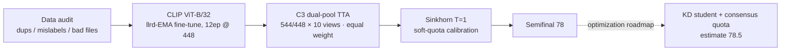

# Fine-Grained Recognition under Noisy Labels

<p align="center">
  <a href="README.md"></a>
  <a href="README.en.md"></a>
</p>

> [!IMPORTANT]
> **In one sentence**: under hard constraints — OpenAI CLIP ViT-B/32 only, a single model / single inference pipeline, and noisy training labels — an llrd-EMA fine-tune (12 epochs · 448px) plus a **C3 dual-resolution 10-view equal-weight TTA** and **Sinkhorn soft-quota calibration** pushed the semifinal score to **78**, with an **optimization roadmap estimated at 78.5 (±0.3)**. This repository open-sources the **research discipline, experiment log and recipes** (no model weights, no competition data).
>
> **Result**: 2026 AIC Algorithm Challenge · Fine-Grained Recognition (robust fine-tuning with noisy labels) · semifinal **78** (local agreement **78.1%**, 37,444 rows / 750 classes) · estimated score **≈78.5 (±0.3)**
>
> **How to read**: research discipline → [docs/research-protocol.md](docs/research-protocol.md) · research log → [docs/research-log.md](docs/research-log.md) · 78-point solution → [docs/semifinal-solution.md](docs/semifinal-solution.md) · reproduction → [docs/reproduction.md](docs/reproduction.md)
>
> **Got compute?** → take the [⚡ Brute-Force Scaling Recipe](#-brute-force-scaling-recipe-advanced) (640px / bs128 / 24–30ep / 3-pool TTA — the goal: give reproducers a shot at beating the 78.5 estimate)


---

## 🏆 Results at a Glance

| Item | Result |
|------|--------|
| Semifinal score (platform) | **78** |
| Local agreement (row-wise vs. organizer reference) | **78.1%** (37,444 rows / 750 classes) |
| **Estimated score** | **≈78.5** (±0.3, calibrated from the 78.1% local agreement) |
| Training recipe | llrd-EMA · 12 epochs · 448px · bs32 · seed 0 · full data |
| Inference | C3 dual-pool (544/448 × 10 views) equal-weight TTA + Sinkhorn T=1 soft quota |
| Backbone constraint | OpenAI CLIP ViT-B/32 (official public weights, mandated by the track) |

## 📈 Score Progression

<p align="center"></p>

> Representative online trajectory (full ledger in [docs/research-log.md](docs/research-log.md)): **61.89** (R4 letterbox geometry mismatch) → **68.43** (R9 CenterCrop geometry fix, +6.54) → **70.80** (kNN weights & view tuning) → **73.02** (448×strongaug schedule + β prior correction) → **78** (final C3 dual-pool equal-weight TTA) → **78.5** (optimization estimate, dashed).
>
> Legend: blue solid = online measurements; green point = final submission result; purple hollow point / dashed = optimization estimate (±0.3).

## 📖 The Challenge and Hard Constraints

- 750 classes / 148,695 training images (**noisy labels**) / 37,444 test images; official metric: Top-1 Accuracy.
- Backbone restricted to OpenAI CLIP ViT-B/32; the final submission allows only a **single model / single fixed inference pipeline**.
- No external data or weights; the test set must not be used for any form of training (pseudo-labels / semi-supervised / self-supervised).
- **Geometry must be consistent across training / validation / submission** — a checklist item earned at a −8pp cost.

## 🧩 Solution Overview



## 🧠 The 78-Point Solution

### Training recipe (llrd-EMA)

| Setting | Value |
| --- | --- |
| Resolution / epochs / batch | 448 / 12 / 32 |
| backbone lr · llrd · head lr | 2e-5 · 0.85 · 1e-3 |
| weight decay · label smoothing | 0.05 · 0.1 |
| mixup · cutmix · mix prob | 0.8 · 1.0 · 0.7 |
| EMA · drop_path · random erasing | 0.9995 · 0.2 · 0.25 |
| degrade_p · cosine margin | 0.875 · 0.2 |
| co-teaching · small-class oversample | on (forget 0.05) · ×4.0 |
| Data side | duplicate exclusion list + SCE head init · seed 0 · full data |

All 13 non-default arguments are pinned in `train_exact.sh` and match the 53-entry training `history.json` record; training-side caches ship in `code/cache/`.

### Inference pipeline (C3 dual-pool equal-weight TTA)

1. **10 views each at 544px and 448px**: orig + mild0–4 ×5 + cc085/070/055/040 ×4;
2. Dual-pool features are **equal-weight averaged** (L2-normalized) → cosine classifier → logits;
3. **Sinkhorn T=1 soft quota** (100 column-scaling rounds, target 49.93 per class; output-side class bias only, no forced flips; 16–70 per class, median 50).

The only change vs. the previously submitted 77.69 package: view aggregation switched from `cc ×3` weighting to **fully equal weights** (+0.075pp, more stable under distribution shift).

## 🚀 Optimization Roadmap (est. 78.5)

The final solution is composed of three components, each with single-variable measurements from the research process ([docs/research-log.md](docs/research-log.md)):

| Component | Measured during research | Role |
| --- | --- | --- |
| KD student (5-teacher consensus soft labels, T=2, 12ep) | 77.743% line (ep12 peak; better than 18ep / T=4) | Consensus soft labels replace hard labels, suppressing noise memorization |
| C3 dual-pool equal-weight TTA | equal weights outperform cc ×3 weighting | Inference-side stabilization (gain near saturation) |
| Consensus quota balancing (`consensus_balance`) + Sinkhorn soft quota | +0.3~1.1pp measured at the output side | Class-distribution calibration without forced flips |

> **Estimation basis**: the final submission's local agreement is **78.1%** (37,444 rows / 750 classes). Through the five-point calibration (`score = 1.0115 × agreement − 0.600`) this is ≈ **78.4**; with the calibration residual (≤0.6pp), the **estimated leaderboard score ≈ 78.5 (±0.3)**. The semifinal result is 78 on the platform; the platform evaluation is authoritative.
>
> Code: `code/scripts/69_teacher_trainset.py` (teacher side) and `code/scripts/consensus_balance.py` (consensus balancing, exploratory tool) are included.

## ⚡ Brute-Force Scaling Recipe (Advanced)

The recipe above is our **measured** reproduction baseline (78.1%). With more compute (multi-GPU A100 / H100, longer training windows), you can take this **compute-for-ceiling** scaling route — the goal: give reproducers a shot at beating the 78.5 estimate.

| Setting | Validated recipe (baseline) | ⚡ Scaled recipe (big VRAM) |
| --- | --- | --- |
| Resolution | 448 | **640** (interpolated pos_embed, end-to-end fine-tune) |
| Batch size | 32 | **128** (or 32 × 4 grad accumulation) |
| Epochs | 12 | **24–30** (scaled together with stronger regularization + EMA) |
| backbone lr | 2e-5 | **3e-5** (conservative sqrt scaling for batch ×4) |
| head lr | 1e-3 | **2e-3** |
| llrd | 0.85 | 0.85 |
| warmup | 5% | **8%** |
| drop_path · random erasing | 0.2 · 0.25 | **0.3 · 0.35** (required regularization for larger updates) |
| EMA decay | 0.9995 | **0.9996** |
| label smoothing | 0.1 | 0.1–0.15 |
| mixup · cutmix · mix_prob | 0.8 · 1.0 · 0.7 | unchanged |
| degrade_p · cosine margin | 0.875 · 0.2 | unchanged |
| co-teaching · small-class oversample | on (forget 0.05) · ×4.0 | unchanged |
| TTA view pools | 544/448 × 10 views, equal weight | **640/544/448 × 10 views, equal weight (3 pools)** |
| KD teachers | 5-teacher consensus · T=2 | **7–9 teachers (incl. 640 members) · T=2** |
| Output calibration | Sinkhorn T=1 | Sinkhorn T=1 + consensus quota balancing |
| Training compute (est.) | ≈150 s/epoch on one RTX 4090D | **≈5–6×** (resolution 2.04× × epochs 2.5×) |
| Inference compute (est.) | 20 views/image (2 pools) | 30 views/image (3 pools, ≈1.5×) |

**Why scale this way (grounded in our verified mechanisms):**

1. **Resolution is the most direct ceiling lever** — this task is about detail fidelity; 640 preserves more texture/stroke information at training time. ⚠️ You **must train end-to-end** with the interpolated pos_embed: we measured a ~4pp drop when a low-res checkpoint was used for high-res inference (position-embedding distribution shift).
2. **Batch ×4 requires matching lr and regularization** — larger batches give more stable noisy gradients, but drop_path / random erasing **must** be strengthened in lockstep, otherwise noise memorization gets worse (2.2% of this dataset is cross-label conflicts).
3. **More epochs only help when paired with higher resolution** — at a fixed resolution we measured the 448 schedule capping at 60ep and peaking at 12ep (18ep regressed); epochs alone overfit. The scaled recipe gives 24–30ep room by combining 640 + stronger regularization + bigger batches, with **EMA weights + pre-registered early stopping** as the backstop.
4. **TTA / distillation are low-risk "compute-for-stability" increments** — single-pool equal-weight gain is nearly saturated (~+0.075pp); 3-pool TTA and more KD teachers mainly improve cross-distribution stability.

**Gating discipline still applies**: validate the scaled recipe on fold0 at ≥ baseline +0.30~0.50pp with macro/middle not degrading before dual-fold and full-data runs; keep train/validation/submission geometry identical (our −8pp lesson).

> Honest note: this section is a **scaling roadmap** for brute-force reproductions — not our measured submission recipe; the combination goes beyond the configurations we validated. If you run it and beat our local agreement or leaderboard score, please open an issue — we will update this table with your results.

## 🔬 Research Discipline (the core of this open-source release)

1. **Audit before modeling**: corruption / exact duplicates / near-duplicates / suspected mislabels first — 1,032 cross-label exact-duplicate groups ≈ 2.2% intrinsic conflict density.
2. **Single-variable + pre-registered gates**: every round goes fold0 → dual-fold → full-data, with pre-registered thresholds (typically +0.30~0.50pp, macro/middle must not degrade).
3. **Strict OOF**: fusion weights / K / τ searched only on inner OOF of the outer-train; validation folds touched once.
4. **Online submissions as designed experiments**: single variable, explicit expectation, calibration ledger backfill; the head-only control package is the reference example.
5. **Negative results archived**: six false gains were blocked by gates — recorded with the same rigor as wins.
6. **Three-way geometry consistency checklist**: training augmentation ↔ validation geometry ↔ submission pipeline; 13 pitfalls in [known-pitfalls](docs/known-pitfalls.md).

→ Protocol: [docs/research-protocol.md](docs/research-protocol.md) · hypothesis design: [docs/experiment-design.md](docs/experiment-design.md) · round-by-round log: [docs/research-log.md](docs/research-log.md)

## ⚙️ Key Experiment Trajectory

| Stage | Change | Local (fold0 / fold1) | Verdict |
| --- | --- | --- | --- |
| B0 baseline | 320 · RRC · last 10 blocks · SCE | 63.71% / — | Fixed baseline |
| D1 | Longest-edge 500 pre-resize (test-domain geometry simulation) | 64.16% / 63.82% | Kept (+0.44pp) |
| R1 retrieval fusion | multi-layer CLS kNN + inner-OOF weight search | 70.28% / 70.38% | **+6.75pp** |
| R4 multi-view TTA | 16 views (3 scales × 5 crops × flip) | 73.43% / 73.34% | +2.9pp |
| R9 geometry fix | CenterCrop instead of letterbox | 76.88% / 77.19% | online **61.89 → 68.43** |
| R6c EMAMIX | EMA + mixup | 66.18% (letterbox protocol) | +2.02pp |
| 448 × strongaug schedule | 10 → 60 epochs | — | online +1.20, capped at 60ep |
| llrd-EMA @448 | 12-epoch peak (vs. 18ep; KD student line 77.743%) | — | Final training recipe |
| C3 equal-weight TTA | dual pool + soft quota | **78.1%** agreement | **Semifinal 78** |
| Optimization roadmap | KD student + equal-weight TTA + consensus quota | 78.1% agreement | **est. ≈78.5** |

## 📂 Repository Structure

```text
.
├── README.md / README.en.md
├── reproduce.sh                 # one-command inference reproduction (TTA + Sinkhorn)
├── train_exact.sh               # exact training command (13 non-default args)
├── verify_submission.py         # 7-point submission self-check
├── code/
│   ├── configs/paths.py         # auto data-root detection (AIC_DATA_ROOT)
│   ├── scripts/                 # full experiment / pipeline scripts (00–76)
│   ├── cache/                   # training-side caches (dup list / SCE head init / noise scores)
│   └── requirements.txt
└── docs/
    ├── research-protocol.md     # research protocol (discipline)
    ├── experiment-design.md     # hypotheses A–E and experiment design
    ├── research-log.md          # semifinal research log (rounds / calibration / negatives)
    ├── data-audit.md            # data audit (preliminary + semifinal)
    ├── semifinal-solution.md    # the 78-point solution (recipe / pipeline / compliance)
    ├── reproduction.md          # reproduction guide
    └── known-pitfalls.md        # 13 pitfalls and their mitigations
```

## 🛡 Release Boundary

This repository **does not contain**: model weights, competition data (train/test images), submission predictions, the organizer reference package, internal server addresses/accounts, or team-member personal information. Some early-round scripts (r-series / b0 training chain) referenced in the research log are not part of this release; the log and conclusions take precedence.

## 🙏 Acknowledgements

- Backbone: OpenAI CLIP (ViT-B/32) official public weights, used only within the track's permitted scope.
- Competition data and evaluation remain the property of the organizers; rules and interpretation rest with them.
- A personal competition research archive maintained by [qiuy-ue](https://github.com/qiuy-ue).
