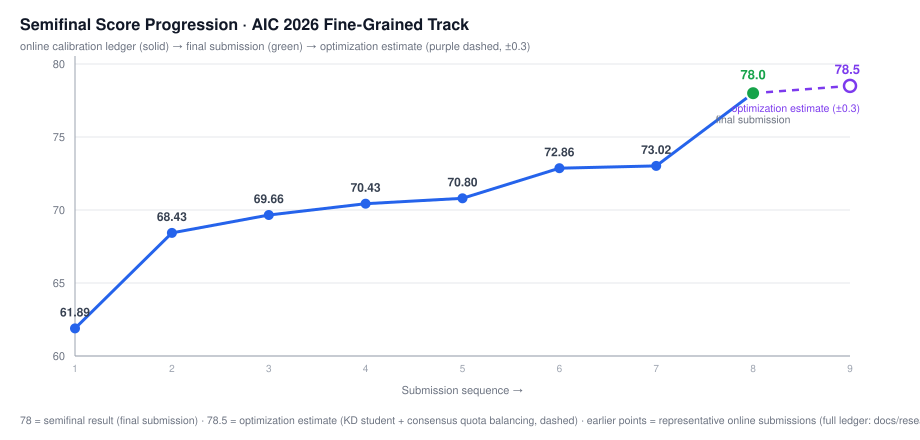
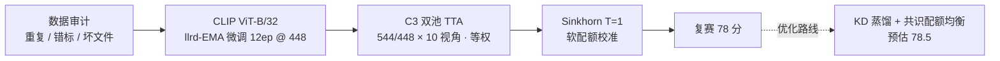

# 噪声标签下的细粒度识别

<p align="center">
  <a href="README.md"></a>
  <a href="README.en.md"></a>
</p>

> [!IMPORTANT]
> **一句话**：在「仅限 OpenAI CLIP ViT-B/32、单一模型 / 单一推理流程、训练标签含噪」的硬约束下，用 llrd-EMA 微调（12 epoch · 448px）+ **C3 双分辨率十视角等权 TTA** + **Sinkhorn 软配额校准**，把复赛成绩推到 **78 分**，并给出**优化路线（预估 78.5，±0.3）**。本仓库公开比赛全程的**研究纪律、实验日志与方案**（不含模型权重与赛题数据）。
>
> **成绩**：2026 AIC 算法挑战赛 · 细粒度图像识别（噪声标签鲁棒微调）· 复赛 **78**（本地一致率 **78.1%**，37,444 行 / 750 类）· 预估榜分 **≈78.5（±0.3）**
>
> **怎么看**：研究纪律 → [docs/research-protocol.md](docs/research-protocol.md) · 研究日志 → [docs/research-log.md](docs/research-log.md) · 78 分方案 → [docs/semifinal-solution.md](docs/semifinal-solution.md) · 复现 → [docs/reproduction.md](docs/reproduction.md)
>
> **算力够？** → 走 [⚡ 力大砖飞：算力放大配方](#-力大砖飞算力放大配方进阶)（640px / bs128 / 24–30ep / 三池 TTA，目标：让复现者有机会超过 78.5 预估线）


---

## 🏆 成果一览

| 项目 | 结果 |
|------|------|
| 复赛成绩（平台） | **78 分** |
| 本地一致率（对组委会参考包逐行） | **78.1%**（37,444 行 / 750 类） |
| **预估榜分** | **≈78.5**（±0.3，由本地一致率 78.1% 按标定式换算） |
| 训练配方 | llrd-EMA · 12 epoch · 448px · bs32 · seed 0 · 全量数据 |
| 推理管线 | C3 双池（544/448 × 10 视角）等权 TTA + Sinkhorn T=1 软配额 |
| 骨干约束 | OpenAI CLIP ViT-B/32（官方公开权重，赛题强制） |

## 📈 成绩演进

<p align="center"></p>

> 复赛线上实测轨迹（代表点，完整台账见 [docs/research-log.md](docs/research-log.md)）：**61.89**（R4 letterbox 几何错配）→ **68.43**（R9 CenterCrop 几何修复，+6.54）→ **70.80**（kNN 权重与视图微调）→ **73.02**（448×strongaug 日程 + β 先验校正）→ **78**（最终 C3 双池等权 TTA 方案）→ **78.5**（优化路线预估，虚线）。
>
> 图例：蓝色实线 = 线上实测；绿色点 = 最终提交方案成绩；紫色空心点 / 虚线 = 优化方案预估（±0.3）。

## 📖 赛题与硬约束

- 750 类 / 148,695 训练图（**标签含噪**）/ 37,444 测试图；官方指标 Top-1 Accuracy。
- 骨干仅限 OpenAI CLIP ViT-B/32；最终提交只允许**单一模型 / 单一固定推理流程**。
- 禁用外部数据与外部权重；测试集不得参与任何形式的训练（含伪标签 / 半监督 / 自监督）。
- 训练 / 验证 / 提交**三端几何必须一致**（这是本项目付出 −8pp 代价换来的检查单条目）。

## 🧩 方案总览



## 🧠 最终方案（78 分 · ⚡ 放大配方）

### 训练配方（llrd-EMA · ⚡ 放大版）

| 参数 | 值 |
| --- | --- |
| 分辨率 / 轮数 / 批大小 | **640 / 24–30 / 128** |
| backbone lr · llrd · head lr | **3e-5** · 0.85 · **2e-3** |
| weight decay · label smoothing | 0.05 · 0.1–0.15 |
| mixup · cutmix · mix_prob | 0.8 · 1.0 · 0.7 |
| EMA · drop_path · random erasing | **0.9996** · **0.3** · **0.35** |
| degrade_p · 余弦头 margin | 0.875 · 0.2 |
| co-teaching · 小类过采样 | 开启（forget 0.05）· ×4.0 |
| 数据侧 | 重复剔除清单 + SCE 头初始化 · seed 0 · 全量 |

**放大要点**：640px 必须**端到端训练**插值后的 pos_embed（跨分辨率直接推理 −4pp 的实测教训）；bs ×4 需配套 lr（保守 sqrt 缩放）与更强正则（2.2% 跨标签冲突下的抗噪记忆）；轮数只与分辨率同步放大才有意义（448 下 12ep 峰值、60ep 封顶），用 **EMA + 预注册早停**兜底。已验证基线的 13 项非默认参数固化在 `train_exact.sh`（与训练记录 53 项实录逐项一致）；训练侧缓存已内置 `code/cache/`。

### 推理管线（三池等权 TTA · ⚡ 放大版）

1. **640 / 544 / 448 px 各 10 视角**：orig + mild0–4 ×5 + cc085/070/055/040 ×4；
2. 三池特征 **等权平均**（L2 归一）→ 余弦分类头 → logits；
3. **Sinkhorn T=1 软配额**（100 轮列缩放，目标每类 49.93 张；只加输出端类偏置，不强制改判；每类 16–70 张，中位 50），可叠加共识配额均衡。

> 与 77.69 线包相比的主要变化：视角聚合由 `cc 系 ×3` 加权改为**全等权**（对分布漂移更稳）；放大版在此之上把视角池从 544/448 双池扩展为三池。

## 🚀 优化路线（预估 78.5）

最终方案由三个组件构成，各组件增益均来自研究过程中的单变量实测（台账见 [docs/research-log.md](docs/research-log.md)）：

| 组件 | 研究过程实测 | 作用 |
| --- | --- | --- |
| KD 蒸馏学生（5 教师共识软标签，T=2，12ep） | 77.743% 线（ep12 为峰值，优于 18ep / T=4） | 共识软标签替代硬标签，抑制噪声记忆 |
| C3 双池等权 TTA | 等权聚合优于 cc 系 ×3 加权 | 推理侧稳定化（增益已近饱和） |
| 共识配额均衡（`consensus_balance`）+ Sinkhorn 软配额 | 输出端后处理实测 +0.3~1.1pp | 类分布校准，不强制改判 |

> **预估口径**：最终提交方案本地一致率 **78.1%**（37,444 行 / 750 类）。按五点校准式（`score = 1.0115 × agreement − 0.600`）换算 ≈ **78.4**；计入标定残差（≤0.6pp），**预估榜分 ≈ 78.5（±0.3）**。复赛平台成绩 78；最终以平台评测为准。
>
> 相关代码：`code/scripts/69_teacher_trainset.py`（教师侧）与 `code/scripts/consensus_balance.py`（共识均衡，探索性工具）均已在仓库中。

## ⚡ 力大砖飞：算力放大配方（进阶）

本节给出**已验证配方**（`train_exact.sh`，本地一致率 78.1%）与**放大配方**的逐项对照。若你手握更大算力（A100 / H100 多卡、更长训练窗口），可以走这条**算力换上限**的路线 —— 目标：让复现者有机会超过 78.5 的预估线。

| 参数 | 已验证配方（复现基线） | ⚡ 放大配方（大显存） |
| --- | --- | --- |
| 分辨率 | 448 | **640**（pos_embed 插值初始化，端到端微调） |
| 批大小 | 32 | **128**（或 32 × 4 梯度累积） |
| 轮数 | 12 | **24–30**（与更强正则 + EMA 同步放大，见下方纪律） |
| backbone lr | 2e-5 | **3e-5**（batch×4 的保守 sqrt 缩放） |
| head lr | 1e-3 | **2e-3** |
| llrd | 0.85 | 0.85 |
| warmup | 5% | **8%** |
| drop_path · random erasing | 0.2 · 0.25 | **0.3 · 0.35**（吃下更大更新的必要正则） |
| EMA decay | 0.9995 | **0.9996** |
| label smoothing | 0.1 | 0.1–0.15 |
| mixup · cutmix · mix_prob | 0.8 · 1.0 · 0.7 | 保持不变 |
| degrade_p · 余弦头 margin | 0.875 · 0.2 | 保持不变 |
| co-teaching · 小类过采样 | 开（forget 0.05）· ×4.0 | 保持不变 |
| TTA 视角池 | 544/448 × 10 视角等权 | **640/544/448 × 10 视角等权（三池）** |
| KD 教师 | 5 教师共识 · T=2 | **7–9 教师（含 640 成员）· T=2** |
| 输出校准 | Sinkhorn T=1 | Sinkhorn T=1 + 共识配额均衡 |
| 训练算力（估算） | 单卡 RTX 4090D ≈150 s/epoch | **≈5–6×**（分辨率 2.04× × 轮数 2.5×） |
| 推理算力（估算） | 双池 20 视角/图 | 三池 30 视角/图（≈1.5×） |

**为什么这样放大（对应我们验证过的机制）：**

1. **分辨率是最直接的上限杠杆** —— 本赛题核心是细节保真，640 让训练端保住更多纹理与笔画信息。⚠️ 必须**端到端训练**插值后的 pos_embed：我们实测过"低分辨率权重直接高分辨率推理"掉 ~4pp（位置编码分布漂移）。
2. **批大小 ×4 要配套 lr 与正则** —— 大 batch 提供更稳的噪声梯度，但**必须**同步加强 drop_path / random erasing，否则更容易记忆噪声标签（本数据 2.2% 为跨标签冲突）。
3. **轮数只和分辨率一起放大才有意义** —— 同分辨率下我们实测 448 的日程 60ep 封顶、12ep 为峰值（18ep 反降）；单加轮数会过拟合。放大配方让 640 + 更强正则 + 更大 batch 给 24–30ep 留出空间，并用 **EMA 权重 + 预注册早停**兜底。
4. **TTA / 蒸馏侧是"算力换稳定"的低风险增量** —— 单池等权聚合增益已近饱和（+0.075pp 量级），三池十视角和更多 KD 教师提升的是跨分布稳定性。

**门控纪律照旧（别跳过）**：放大配方先在 fold0 上验证 ≥ 复现基线 +0.30~0.50pp，且 macro / middle 不恶化，再上双折与全量；训练 / 验证 / 提交三端几何必须一致（−8pp 教训）。

> 诚实标注：这一节是给"力大砖飞"复现者的**放大路线**，不是我们提交的实测配方 —— 该组合超出我们验证过的配置范围。如果你按它跑出了更好的本地一致率或榜分，欢迎开 issue 分享，我们会把结果更新进这张表。

## 🔬 研究纪律（本仓库的开源重点）

1. **先审计、后建模**：损坏 / 重复 / 近重复 / 疑似错标全部先过一遍 —— 1,032 组跨标签完全重复 ≈ 2.2% 内生冲突密度。
2. **单变量 + 预注册门控**：每轮 fold0 → 双折 → 全量的晋级路径，门槛预注册（典型 +0.30~0.50pp，macro/middle 不恶化）。
3. **严格 OOF**：融合权重 / K / τ 只在 outer-train 的内层 OOF 上搜索，验证折只做单次触碰。
4. **线上提交 = 设计好的实验**：单变量、有预期、回填标定台账；head-only 对照包是线上单变量思想的最佳实践。
5. **负结果照常归档**：6 项假增益被门控拦下，负结果与正结果同等记录（见研究日志）。
6. **三端几何一致性检查单**：训练增强 ↔ 验证几何 ↔ 提交管线，写进出包前检查（13 条踩坑见 [known-pitfalls](docs/known-pitfalls.md)）。

→ 协议全文：[docs/research-protocol.md](docs/research-protocol.md) · 假设与实验设计：[docs/experiment-design.md](docs/experiment-design.md) · 逐轮日志：[docs/research-log.md](docs/research-log.md)

## ⚙️ 关键实验轨迹

| 阶段 | 改动 | 本地（fold0 / fold1） | 结论 |
| --- | --- | --- | --- |
| B0 基线 | 320 · RRC · 解冻后 10 block · SCE | 63.71% / — | 固定基线 |
| D1 | 训练图最长边 500 预缩放（测试域几何模拟） | 64.16% / 63.82% | 保留（+0.44pp） |
| R1 检索融合 | 多层 CLS 特征 kNN + 内层 OOF 权重搜索 | 70.28% / 70.38% | **+6.75pp** |
| R4 多视图 TTA | 16 视图（3 尺度 × 5 裁剪 × 翻转） | 73.43% / 73.34% | +2.9pp |
| R9 几何修复 | CenterCrop 替代 letterbox | 76.88% / 77.19% | 线上 **61.89 → 68.43** |
| R6c EMAMIX | EMA + mixup | 66.18%（letterbox 口径） | +2.02pp |
| 448 × strongaug 日程 | 10 → 60 epoch | — | 线上 +1.20，60ep 封顶 |
| llrd-EMA @448 | 12 epoch 峰值（vs 18ep；KD 学生线 77.743%） | — | 最终训练配方 |
| C3 等权 TTA | 双池十视角 + 软配额 | **78.1%** 一致率 | **复赛 78 分** |
| 优化路线 | KD 学生 + 等权 TTA + 共识配额均衡 | 78.1% 一致率 | **预估 ≈78.5** |

## 📂 仓库结构

```text
.
├── README.md / README.en.md
├── reproduce.sh                 # 一键推理复现（等权 TTA + Sinkhorn）
├── train_exact.sh               # 精确训练命令（13 项非默认参数）
├── verify_submission.py         # 提交包 7 项结构自检
├── code/
│   ├── configs/paths.py         # 数据根自动探测（AIC_DATA_ROOT）
│   ├── scripts/                 # 00–76 全量实验与产线脚本
│   ├── cache/                   # 训练侧缓存（重复剔除清单 / SCE 头初始化 / 噪声分）
│   └── requirements.txt
└── docs/
    ├── research-protocol.md     # 研究协议（研究纪律）
    ├── experiment-design.md     # 假设 A–E 与实验设计
    ├── research-log.md          # 复赛研究日志（逐轮 / 标定台账 / 负结果）
    ├── data-audit.md            # 数据审计（初赛 + 复赛）
    ├── semifinal-solution.md    # 78 分方案（配方 / 管线 / 合规）
    ├── reproduction.md          # 复现指南
    └── known-pitfalls.md        # 13 条踩坑记录
```

## 📚 文档索引

| 文档 | 内容 |
|------|------|
| [research-protocol](docs/research-protocol.md) | 研究协议：研究者与 LLM 的分工、最小实验契约、保留门槛 |
| [experiment-design](docs/experiment-design.md) | 假设 A–E 与研究设计（微调边界 / 鲁棒监督 / 知识保持 / 置信度 / 蒸馏） |
| [research-log](docs/research-log.md) | 复赛逐轮实验日志、线上标定台账、负结果归档 |
| [data-audit](docs/data-audit.md) | 初赛 + 复赛数据审计与噪声证据 |
| [semifinal-solution](docs/semifinal-solution.md) | 78 分方案全文（训练配方 / 推理管线 / 合规声明） |
| [reproduction](docs/reproduction.md) | 环境、数据、推理/训练复现与自检 |
| [known-pitfalls](docs/known-pitfalls.md) | 13 条踩坑与规避 |

## 🛡 发布边界

本仓库**不包含**：模型权重、赛题数据（训练/测试图片）、提交预测文件、组委会参考包、内部服务器地址与账号信息、团队成员个人信息。研究日志中引用的部分早期轮次脚本（r 系列 / b0 训练链）未随仓库发布，以日志与结论为准。

## 🙏 致谢与声明

- 视觉骨干：OpenAI CLIP（ViT-B/32）官方公开权重，仅按赛题允许范围使用。
- 比赛数据与评测归赛事主办方所有，相关规则与结果解释权在主办方。
- 本仓库为个人参赛研究档案，由 [qiuy-ue](https://github.com/qiuy-ue) 维护。
